# TAXI APP

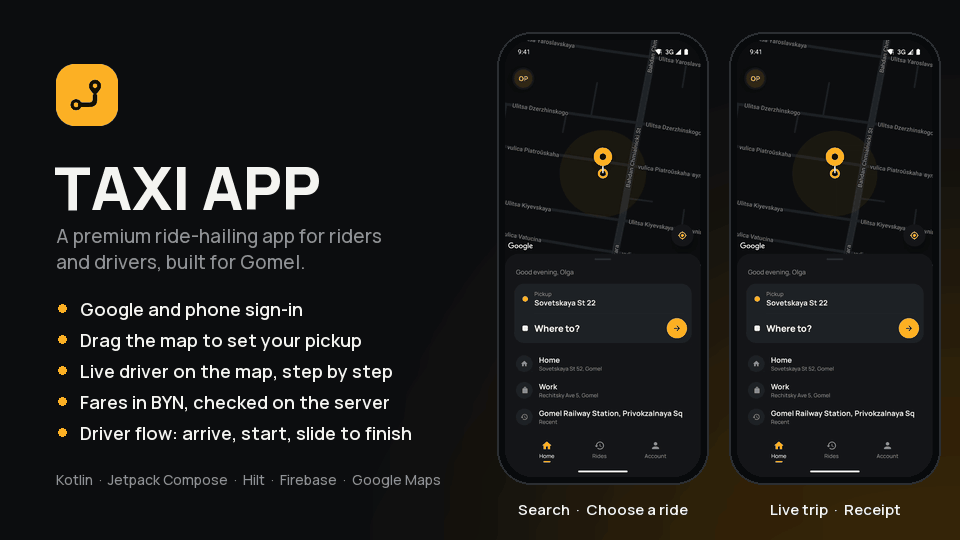

A ride-hailing app for Android with a rider side and a driver side, set up for Gomel, Belarus. Riders set their pickup by dragging the map, choose a ride, and follow their driver live. Drivers go online, accept nearby requests and take each trip through arrive, start and finish. Fares are in Belarusian roubles (BYN), and the server re-checks every price.

The interface uses the **Signal Amber** theme: graphite surfaces with one taxi-amber accent, Manrope type, and a dark or light map to match. Every screen is built with Jetpack Compose, with shimmer placeholders while content loads and spring-based motion.

## Features

**Riders**
- Sign in with Google or a phone number (6-digit SMS code with auto-fill).
- Drag the map to set an exact pickup point; the street address updates when the pin settles.
- Search with Google Places, falling back to the phone's own geocoder, or **choose a destination on the map**.
- Pick Economy, Premium or XL, see the road route, the distance, the time and an arrival estimate.
- Follow the trip live: finding a driver, driver on the way with their car moving on the map, arrived, on the trip.
- A receipt at the end, with a PDF version saved to Downloads.

**Drivers**
- Go online or offline, see today's earnings and nearby trip requests on the map.
- Take each trip through **I've arrived → Start trip → Slide to finish**, with turn-by-turn navigation in Google Maps.
- The driver's position is shared with the rider during the trip.
- For cash trips, a "collect payment" sheet shows the amount and the fare breakdown.

**Security**
- Realtime Database rules check every field: who may write it, valid values, and allowed status changes.
- A Cloud Function recalculates each fare on the server and cancels trips with a tampered price.
- Notifications are sent by Cloud Functions, so no service-account key ships inside the app.

## Screenshots

### Sign in

| Onboarding | Phone number | Code |
|:---:|:---:|:---:|
| 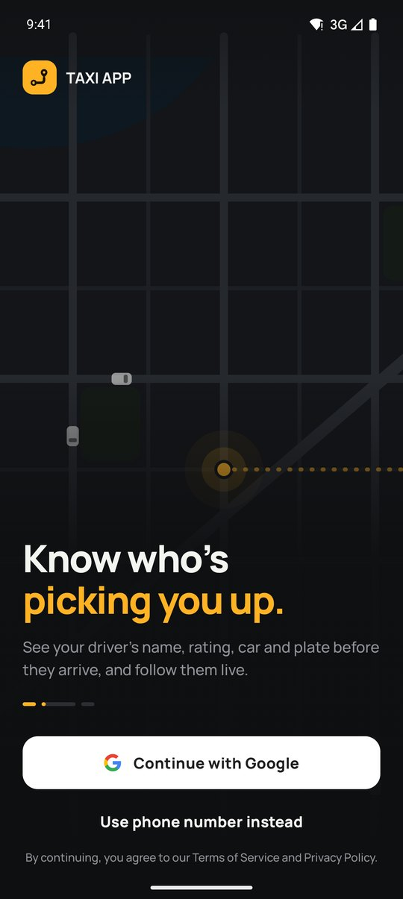 | 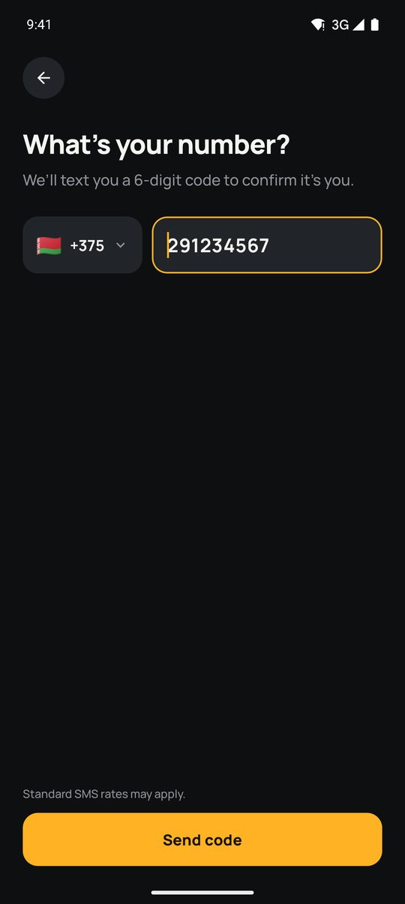 |  |

### Rider

| Home | Your rides | Account |
|:---:|:---:|:---:|
|  |  |  |

| Where to? | Search results | Choose on map |
|:---:|:---:|:---:|
|  | 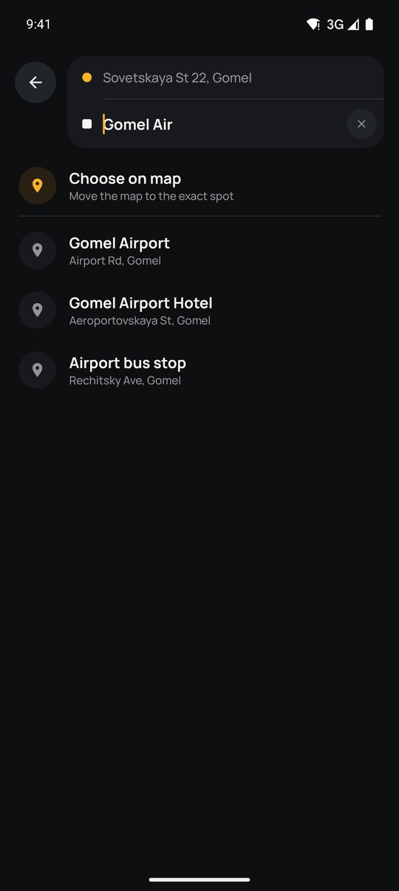 | 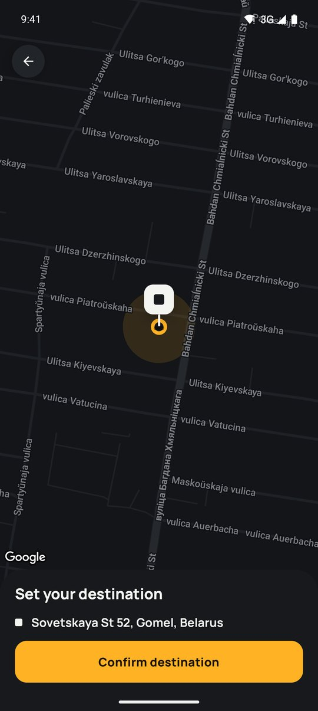 |

| Choose a ride | Finding your driver | Driver on the way |
|:---:|:---:|:---:|
|  |  |  |

| Driver arrived | On the trip | Receipt |
|:---:|:---:|:---:|
| 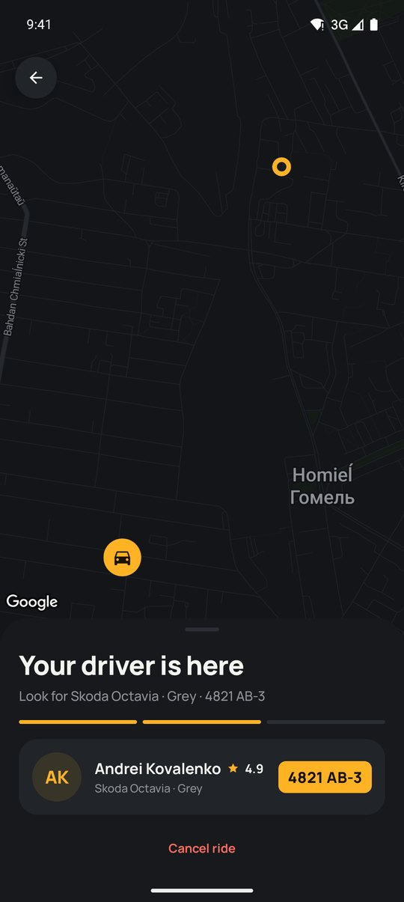 | 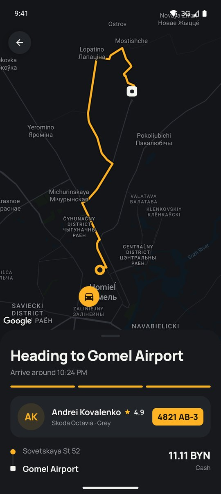 | 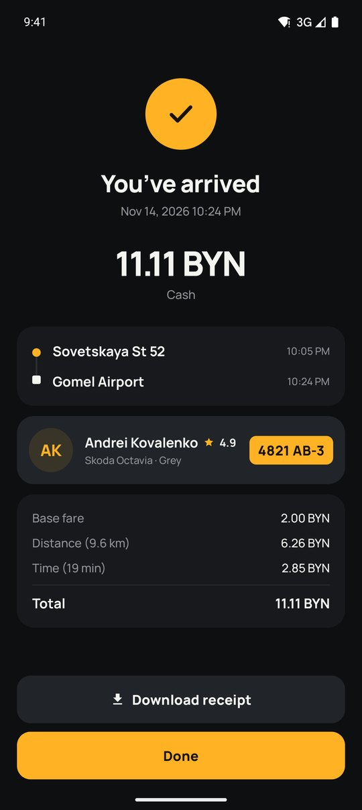 |

### Driver

| Offline | Online with requests | Pick up |
|:---:|:---:|:---:|
| 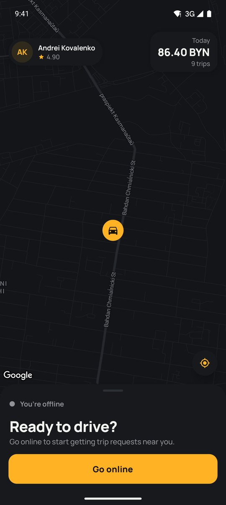 |  | 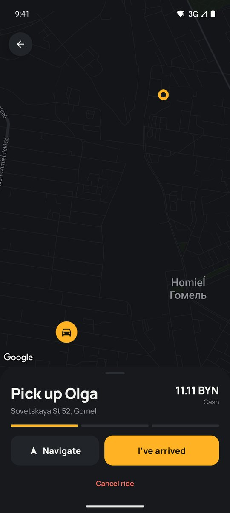 |

| Waiting for the rider | Drop off | Collect payment | Trip complete |
|:---:|:---:|:---:|:---:|
|  | 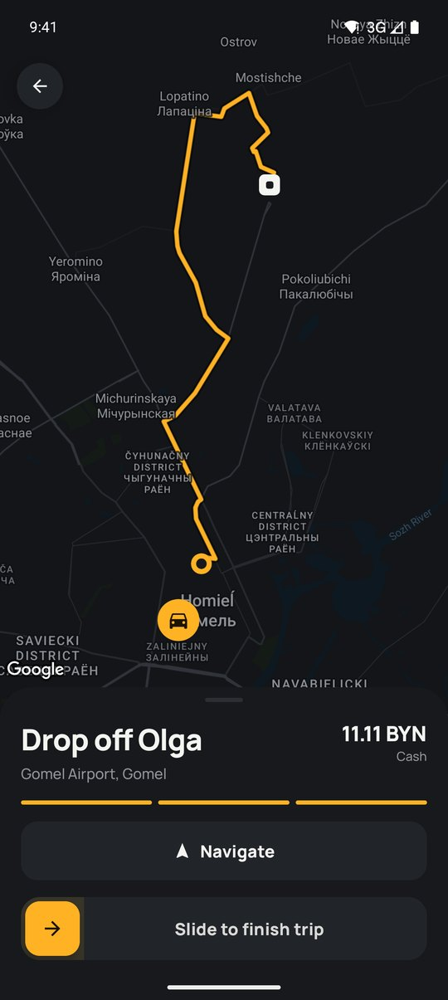 | 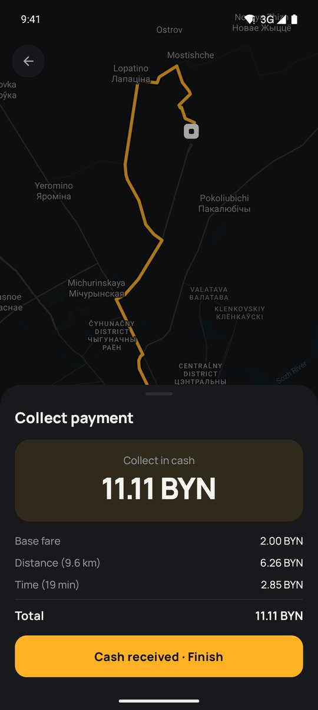 |  |

## Fares

Prices are in BYN, worked out from the straight-line distance and an estimated time. The same rates live in `app/src/main/java/com/taxiapp/util/Pricingengine.kt` and `functions/pricing.js`, so change both together.

| Ride | Base | Per km | Per minute | Minimum |
|---|---:|---:|---:|---:|
| Economy | 2.00 | 0.65 | 0.15 | 4.50 |
| Premium | 3.00 | 0.90 | 0.22 | 6.50 |
| XL | 3.50 | 1.00 | 0.25 | 7.50 |

## Tech stack

Kotlin · Jetpack Compose (Material 3) · Hilt · Coroutines and Flow · Firebase Auth, Realtime Database, Cloud Messaging and Cloud Functions (Node 22) · Google Maps (maps-compose) · Places SDK · Credential Manager · Coil · Media3

## Setup

1. Add `app/google-services.json` from your Firebase project.
2. Create `local.properties` in the project root:
   ```properties
   MAPS_API_KEY=your-android-maps-key
   ```
   The Google sign-in web client ID is read from `google-services.json`.
3. In Firebase Authentication, enable **Google** and **Phone**, and add your app's SHA-1 and SHA-256 fingerprints.
4. In Google Cloud, turn on billing for the project that owns the Maps key and enable **Maps SDK for Android**, **Places API (New)**, **Directions API** and **Geocoding API**.
5. Deploy the backend (needs the Blaze plan):
   ```bash
   firebase functions:secrets:set MAPS_SERVER_KEY
   firebase deploy --only functions,database
   ```
6. Driver accounts need `role: "driver"` set on `users/{uid}` (from the console or the Admin SDK; the app can't grant it).

Run the tests:

```bash
cd functions
npm test             # fare calculation
npm run test:rules   # database rules, against the emulator
```

## Notes

- Until `getRoute` is deployed, road routes come from the public OSRM demo server (`router.project-osrm.org`) as a stand-in. That sends each trip's two end points to a third party and is only allowed for light use, so remove `osrmRoute` in `DirectionsRepository.kt` before release.
- The driver's location is shared only while the trip screen is open; sharing it in the background needs a foreground service.
- The map starts over Gomel until the first location fix.
- Manrope is used under the SIL Open Font License (see `licenses/`).
