<div align="center">


#  Taxi App
### A real-time ride-hailing app for passengers and drivers

[](https://kotlinlang.org/)
[](https://developer.android.com/)
[](https://developer.android.com/compose)
[](https://firebase.google.com/)
[](https://developers.google.com/maps)
[](#)

</div>


---

## Overview

**Taxi App** is a native Android ride-hailing application built with Kotlin, Jetpack Compose and Firebase, developed by [AhmadALSaffan](https://github.com/AhmadALSaffan). It serves both **passengers** and **drivers** with dedicated interfaces, and is set up for Gomel, Belarus. Passengers set their pickup by dragging the map, choose a ride and follow their driver live. Drivers go online, accept nearby requests and take each trip through arrive, start and finish. Fares are in Belarusian roubles (BYN), and the server re-checks every price.

The interface uses the **Signal Amber** theme: graphite surfaces with one taxi-amber accent, Manrope type, and a dark or light map to match. Every screen has shimmer placeholders while content loads and spring-based motion.

---

## Screenshots

### Sign in

| Onboarding | Phone number | Code |
|:---:|:---:|:---:|
|  |  | 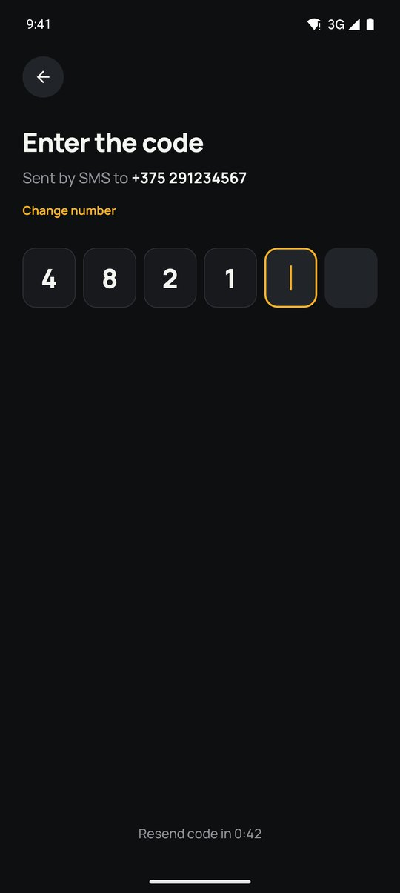 |

### Passenger

| Home | Your rides | Account |
|:---:|:---:|:---:|
| 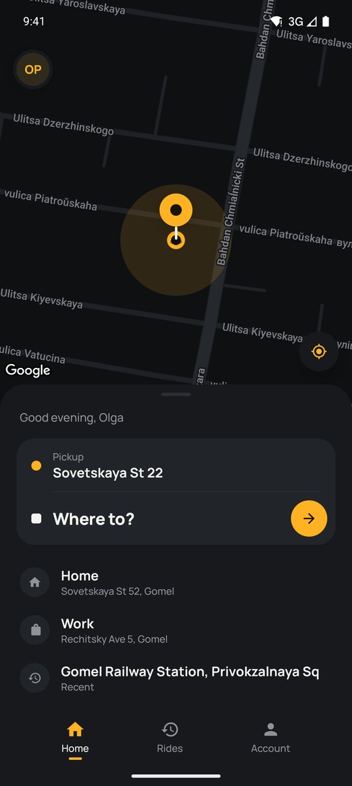 | 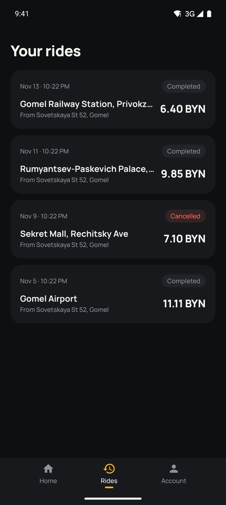 | 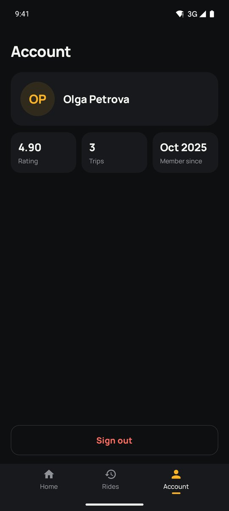 |

| Where to? | Search results | Choose on map |
|:---:|:---:|:---:|
| 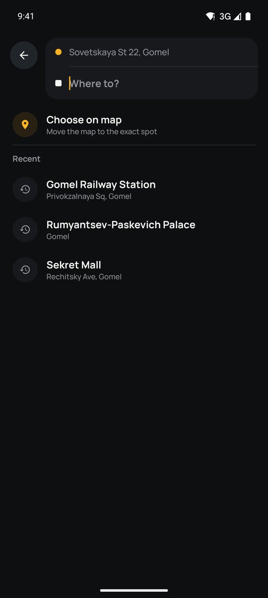 |  |  |

| Choose a ride | Finding your driver | Driver on the way |
|:---:|:---:|:---:|
| 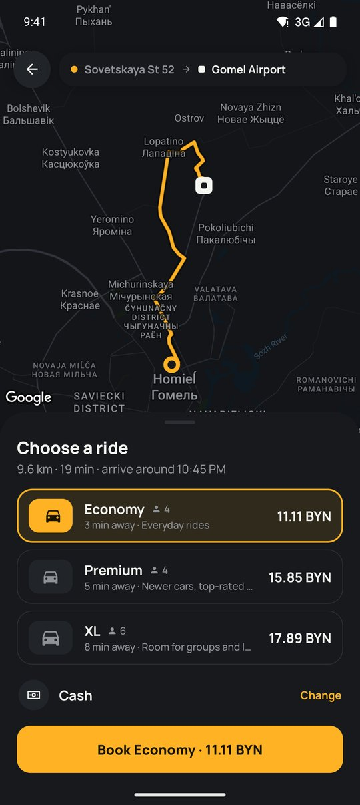 | 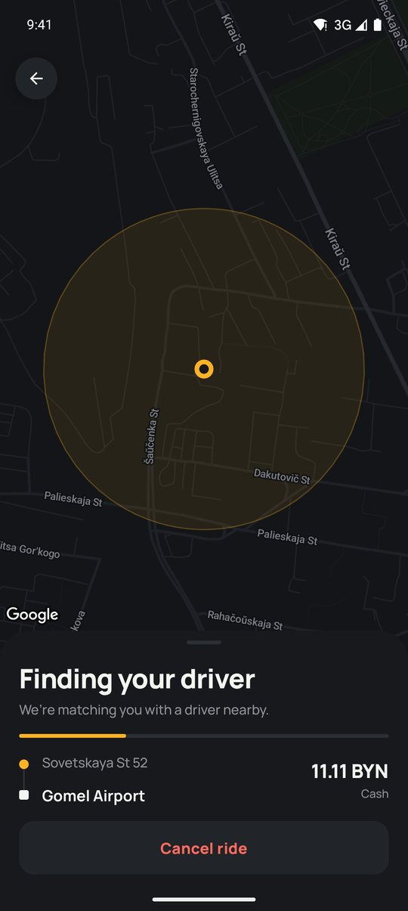 | 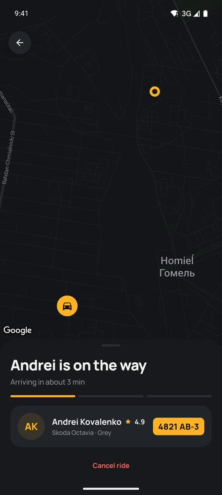 |

| Driver arrived | On the trip | Receipt |
|:---:|:---:|:---:|
|  |  |  |

### Driver

| Offline | Online with requests | Pick up |
|:---:|:---:|:---:|
|  | 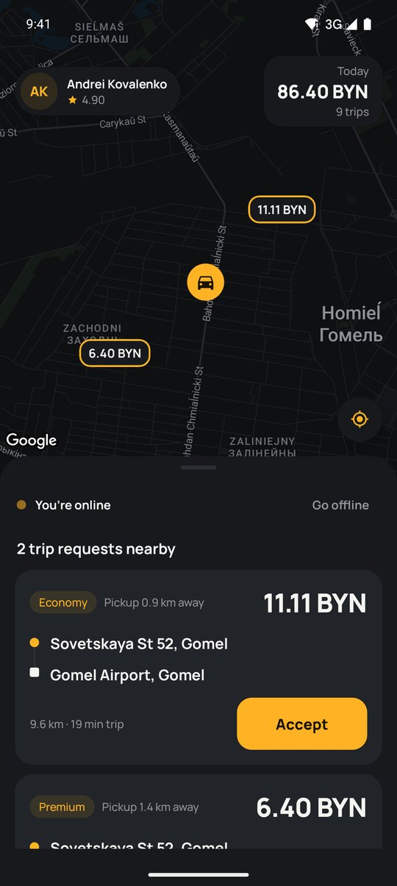 |  |

| Waiting for the rider | Drop off | Collect payment | Trip complete |
|:---:|:---:|:---:|:---:|
| 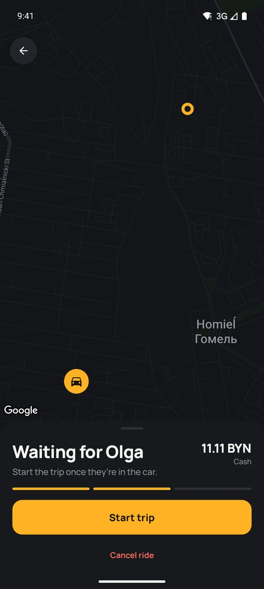 |  |  | 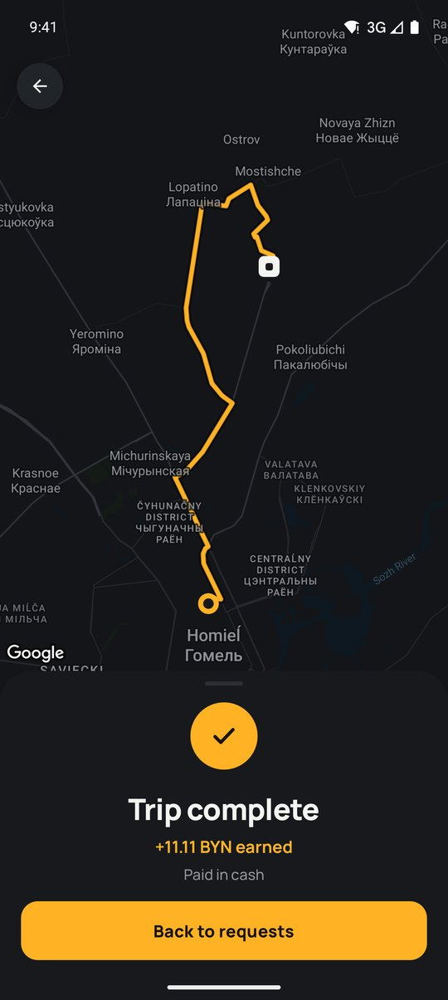 |

---

## Features

### 🧍 Passenger
- 🔐 **Sign in** — Google sign-in, or a phone number with a 6-digit SMS code (auto-filled when it arrives)
- 📍 **Set your pickup** — Drag the map under the pin; the street address updates when it settles
- 🔎 **Find a destination** — Google Places search, the phone's own geocoder as a fallback, or **choose on map**
- 💰 **Choose a ride** — Economy, Premium or XL with the road route, distance, time and an arrival estimate
- 🗺️ **Live trip** — Finding a driver → driver on the way (car moving on the map) → arrived → on the trip
- 🧾 **Receipt** — Fare breakdown at the end, with a PDF saved to Downloads
- 🕘 **Ride history** — Past trips, each opening its receipt

### 🚗 Driver
- 📲 **Ride requests** — Go online, see nearby requests and today's earnings on the map
- 🚦 **Trip steps** — I've arrived → Start trip → Slide to finish
- 🧭 **Navigation** — Opens turn-by-turn directions in Google Maps
- 📡 **Live location** — Shared with the passenger during the trip
- 💵 **Cash trips** — A "collect payment" sheet with the amount and the fare breakdown

### ⚙️ General
- 🛡️ **Server-checked fares** — A Cloud Function re-prices every trip and cancels tampered ones
- 🔒 **Database rules** — Every field is validated: who may write it, valid values, allowed status changes
- 🔔 **Push notifications** — Sent by Cloud Functions; no service-account key ships in the app
- 🎨 **Signal Amber design** — Dark and light themes, skeleton loading, smooth motion

---

## Fares

Prices are in BYN, worked out from the straight-line distance and an estimated time. The same rates live in `app/src/main/java/com/taxiapp/util/Pricingengine.kt` and `functions/pricing.js`, so change both together.

| Ride | Base | Per km | Per minute | Minimum |
|---|---:|---:|---:|---:|
| Economy | 2.00 | 0.65 | 0.15 | 4.50 |
| Premium | 3.00 | 0.90 | 0.22 | 6.50 |
| XL | 3.50 | 1.00 | 0.25 | 7.50 |

---

## Tech Stack

| Layer | Technology |
|---|---|
| Language | Kotlin 2.2, Coroutines and Flow |
| UI | Jetpack Compose (Material 3), Manrope |
| Architecture | MVVM, Hilt |
| Maps | Google Maps SDK (maps-compose), Places SDK |
| Auth | Firebase Authentication (Google via Credential Manager, Phone) |
| Realtime Database | Firebase Realtime Database with validated security rules |
| Backend | Cloud Functions for Firebase (Node 22): fare checks, routes, notifications |
| Push Notifications | Firebase Cloud Messaging (FCM) |

---

## Getting Started

### Prerequisites

- Android Studio (latest stable)
- JDK 17+
- A Firebase project on the **Blaze** plan (needed for Cloud Functions)
- A **Google Maps API key** from a Google Cloud project with billing enabled

### 1 — Clone the Repository

```bash
git clone https://github.com/AhmadALSaffan/TAXI-APP.git
cd TAXI-APP
```

### 2 — Add Google Maps API Key

Add your Maps API key to `local.properties`:

> ⚠️ **Never commit `local.properties`.** It is already listed in `.gitignore`.

```properties
# local.properties
MAPS_API_KEY=your_google_maps_key_here
```

In Google Cloud, enable **Maps SDK for Android**, **Places API (New)**, **Directions API** and **Geocoding API** for that key's project.

### 3 — Add Firebase Config

1. Go to your [Firebase Console](https://console.firebase.google.com/) → Project settings → Download **`google-services.json`**
2. Place it in `app/google-services.json`
3. Enable **Google** and **Phone** sign-in, add your app's SHA-1 and SHA-256 fingerprints, and enable **Realtime Database**

The Google sign-in web client ID is read from `google-services.json`.

### 4 — Deploy the Backend

```bash
firebase functions:secrets:set MAPS_SERVER_KEY
firebase deploy --only functions,database
```

Driver accounts need `role: "driver"` on `users/{uid}`, set from the console or the Admin SDK (the app can't grant it).

### 5 — Build & Run

```bash
./gradlew assembleDebug
```

Or press **▶ Run** in Android Studio.

### Tests

```bash
cd functions
npm test             # fare calculation
npm run test:rules   # database rules, against the emulator
```

---

## Project Status

This project is currently **under active development**. Planned upcoming features include:

- [ ] In-app payment integration
- [x] Push notifications for ride requests
- [ ] Driver ratings and reviews
- [x] Ride history for passengers
- [ ] Admin dashboard
- [ ] Background location for drivers (foreground service)

> **Note:** until `getRoute` is deployed, road routes come from the public OSRM demo server (`router.project-osrm.org`) as a stand-in. It receives each trip's two end points and only allows light use, so remove `osrmRoute` in `DirectionsRepository.kt` before release.

---

## Contributing

Pull requests are welcome! For major changes, please open an issue first to discuss what you'd like to change.

1. Fork the repo
2. Create your feature branch: `git checkout -b feature/your-feature`
3. Commit your changes: `git commit -m "feat: add your feature"`
4. Push to the branch: `git push origin feature/your-feature`
5. Open a Pull Request

---

## License

```text
This is my project — any help, feedback, or contributions are more than welcome!
```

Manrope is used under the SIL Open Font License (see `licenses/`).

---

<div align="center">
  Built with ❤️ by <a href="https://github.com/AhmadALSaffan">Ahmad AlSaffan</a>
</div>
